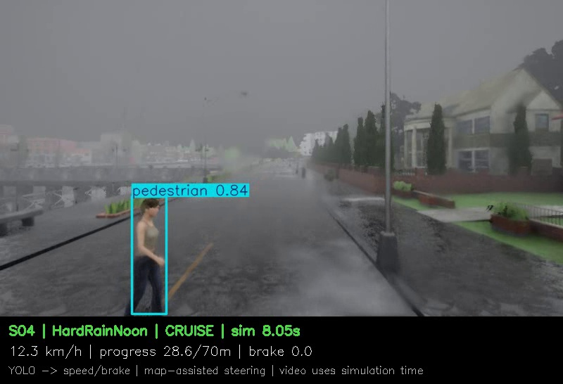

# S04：雨天较晚横穿的失败与复测

## 已核验的观察

- 对照条件：自车距横穿点12m时，行人才以1.0m/s开始横穿；天气以外的设置相同。
- 晴天首次制动7.45秒，8.30秒达到停车阈值，22.50秒无碰撞进入终点范围。
- 雨天首次制动7.85秒，8.05秒释放刹车，8.95秒碰撞传感器记录与行人接触。
- 松刹时仍有行人检测框，置信度0.84；近似横向位置估计为-1.916m，超出当前±1.9m筛选范围，于是危险判断变为False，车辆恢复油门。
- 随后接近行人时还出现无检测帧，当前单帧控制没有保持先前的危险状态。

这是检测、几何估计和控制衔接的问题，不能简单归因于“YOLO完全没有看见行人”。图中行人下半身已接近画面边缘；框截断及单目估计误差可能影响横向判断，但其各自作用尚未通过独立实验分离。

## 复测

S04晴雨各额外复测一次，配置与原S04逐项核对一致：晴天再次通过，雨天再次碰撞，记录时间分别仍为22.50秒与8.95秒。两次复测单独报告，不把同一场景重复当作新增独立场景。

- [晴天复测视频](videos/S04_recheck_ClearNoon.mp4)
- [雨天复测视频](videos/S04_recheck_HardRainNoon.mp4)
- [复测核验与诊断数据](failure_and_recheck_evidence.json)
- [失败附近的控制数据](S04_rain_failure_control.csv)
- [失败附近的检测框数据](S04_rain_failure_detections.csv)

## 后续可研究的改进

可以研究保持已有危险目标状态、对临界横向判断增加滞回、处理画面边缘的截断目标框，并在固定场景上评价碰撞、误停车和等待时间。当前尚未实现或验证这些改进，不能声称任何一个已经解决碰撞。

本次保留失败基线，不为提高表面通过率而调参重跑。正式研究仍需更多独立场景与重复试验，也需要单独验证数据增强训练的效果。
